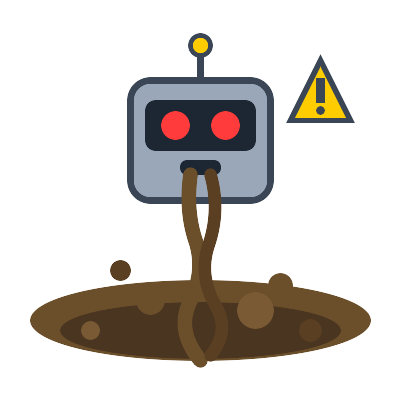

# AI Slop Will Kill Us All 🤖💀
### A Cheerful Obituary for the Internet, Written by (Probably) an AI

<!-- end_slide -->

## The Internet Used to Be Good-ish 🌐

Back in the day, nonsense on the internet was lovingly hand-crafted by a human with too much free time.

Now every blog post is 2,000 words of "As an AI language model, I don't have feelings, but here are ten ways to boil water."

The dead internet theory isn't a theory anymore — it's a *business model*. 🪦

<!-- end_slide -->

## SEO Has Been Replaced by Slo 🥣

Search engines used to find answers; now they find twelve paragraphs of warm, confident nothing before the recipe.

Every "helpful" article is a robot summarizing three other robots summarizing one tired human from 2009.

Congratulations, you've just read 800 words to learn that yes, you should turn off the oven. 🔥

<!-- end_slide -->

## Art Is Now "Art" 🎨

Why commission a struggling illustrator when a model can hallucinate a woman with seven fingers and three elbows?

Each generated image contains approximately one gallon of water and zero grams of consent. 💧🚫

Masterpieces, truly — if your definition of masterpiece is "looks okay until you zoom in one inch." 🔍

<!-- end_slide -->

## The Comment Section Is Already Dead 💬

Half the reviews on your favorite shop are bots arguing with other bots about a product that doesn't exist.

That heartfelt testimonial from "Karen M." was written by a language model that has never met a Karen.

Soon the only real human online will be a confused grandma asking why her toaster has opinions. 👵

<!-- end_slide -->

## Trust Is the First Casualty 🩸

When everything might be fake, nothing is believed — including, ironically, the true things. 🤷

A real photo of a real disaster gets dismissed as "AI-generated" while a fake one goes viral as "breaking news."

We're building a world where the best lie is just *plausible enough pixels*. 🖼️

<!-- end_slide -->

## The Slop Will Outnumber Us 📈

Every human produces maybe a few thousand words a day; one model spits out a billion before lunch. 🍽️

Soon the ratio of slop-to-human-content will exceed the ratio of coffee-to-engineer, and that's saying something. ☕

We will be a tiny, overwhelmed minority in an ocean of our own confident robot vomit. 🌊

<!-- end_slide -->

## But Wait — Slop Could Save Us! 🦸

If we drown the bad actors in so much garbage that nobody can find their misinformation, the slop defends us. 🛡️

The bots will get so busy arguing with other bots that humans can finally touch grass in peace. 🌱

Embracing the slop is the only way to survive the slop — fight garbage with garbage, friends. ♻️

<!-- end_slide -->

## Conclusion

**AI slop won't kill us — it'll make us so numb to nonsense that only genuine human connection will feel real again. 🫶🌍**

<!-- end_slide -->
